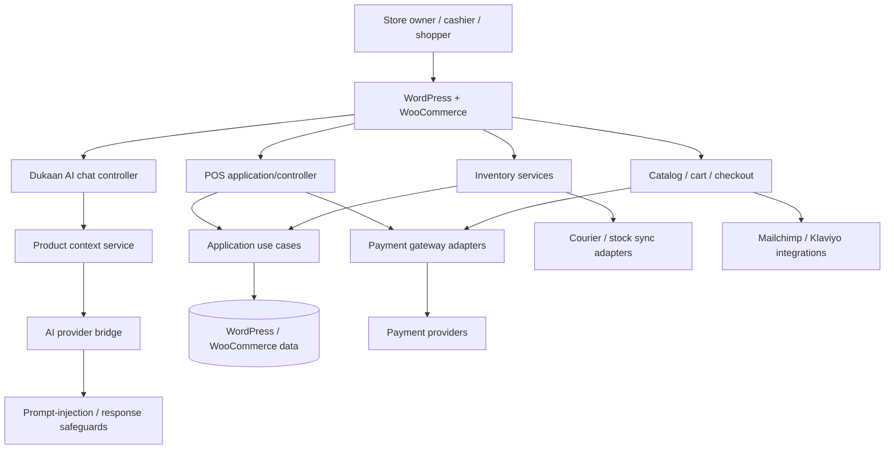

# Juncsys / Junction Systems — Project Context

> Product site: https://juncsys.com. Source review of private repository `haseeb1984/Junction-Systems`, branch `main`, reviewed 2026-11-13. Owner identifies POS, Inventory, Ecommerce and Dukaan AI as the core product areas.

## Purpose
WordPress/WooCommerce-oriented business platform combining POS, inventory, ecommerce, AI-assisted shopping/support and business integrations.

## Stack and dependencies
- WordPress theme/plugin PHP architecture with WooCommerce integration.
- PHP Composer configuration was not present at repository root in the inspected tree; WordPress/WooCommerce runtime dependencies are supplied by the host/plugin environment.
- External service credentials belong in environment/configuration, never committed source.

## Architecture

## Main flows
### POS
1. Cashier opens/uses a session.
2. Sale use case validates items, quantities and payment splits.
3. Stock movement is attempted and sale/receipt/order history is recorded.
4. Offline queued operations can synchronize when connectivity returns.

### Inventory
1. User manages stock by location.
2. Adjustments and purchase orders create stock movement records.
3. Low-stock tracking and barcode generation support operations.
4. WooCommerce stock synchronization keeps ecommerce inventory aligned.

### Ecommerce and fulfilment
1. Customer browses WooCommerce catalogue and adds items to cart.
2. Checkout processes order/payment.
3. Payment adapters support JazzCash, EasyPaisa and COD OTP verification paths.
4. Courier adapters include TCS, Leopards and Trax integration architecture.

### Dukaan AI
1. Chat request is received by AI controller.
2. Product context is assembled from catalogue data.
3. Prompt-injection checks and provider bridge process the request.
4. Urdu/English response is returned, including streaming response support where configured.

## Feature inventory (source-reviewed)
- POS cashier sessions, sales, split payments, receipts, order history and offline queue sync.
- Multi-location inventory, stock movements, purchase orders, low-stock tracking, barcode generation and WooCommerce stock sync.
- WooCommerce catalogue, cart, checkout and physical/digital product support.
- Dukaan AI Urdu/English chat, product-aware context, streaming and provider integration.
- JazzCash, EasyPaisa and COD OTP verification code paths.
- TCS, Leopards and Trax courier integration architecture.
- Affiliate/referral registration, tracking, commissions and payout workflows.
- Mailchimp and Klaviyo marketing integrations.

## Roadmap
1. Tighten POS authorization to dedicated financial-operation capabilities and role checks.
2. Define transactional consistency policy when stock deduction fails during sale (reject, reserve, or explicitly allow overselling).
3. Add automated tests for POS totals, split payments, inventory invariants, checkout and offline sync.
4. Validate AI provider/model routing and document supported provider/model combinations.
5. Add webhook/idempotency and reconciliation tests for payment/courier callbacks.
6. Document plugin/theme installation, WooCommerce prerequisites, environment settings and backup/restore.

## Gaps and verification register
- Inspected POS permission callback accepted `manage_woocommerce` OR `edit_posts`; the latter may be too broad for financial operations.
- POS sale path appeared able to continue if stock deduction fails; confirm intended overselling/consistency behavior.
- One AI service path appeared to send a Gemini model identifier through an OpenAI provider; verify provider/model routing and whether the path is active.
- No dedicated automated test files were found in the inspected tree.
- Theme metadata version and internal `PKSTORE_VERSION` appeared inconsistent; verify release/versioning convention.
- These are code-review findings to validate, not proof that the owner-tested product is non-functional.
